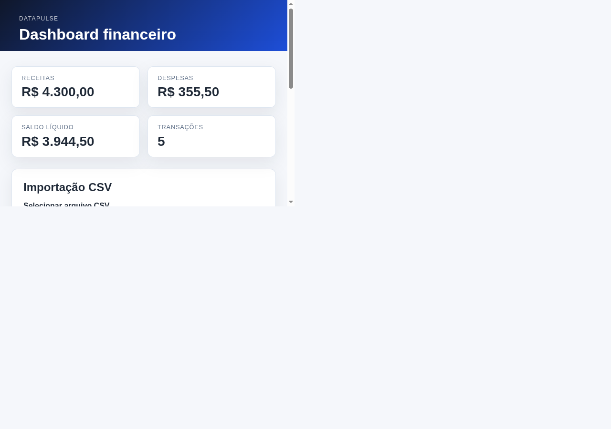

# DataPulse

DataPulse é um dashboard financeiro de portfólio para acompanhar receitas, despesas, saldo líquido e tendências de categoria com uma arquitetura simples e reproduzível em R, Plumber, JavaScript e SQLite.

## Objetivo

O projeto resolve a necessidade de registrar transações financeiras, validar entradas, analisar comportamento por categoria e apresentar indicadores em uma interface web leve. A solução prioriza manutenção clara, lógica centralizada em R e testes automatizados sobre o fluxo real de análise e persistência.

## Funcionalidades implementadas

- Dashboard com indicadores de receitas, despesas, saldo líquido e quantidade de transações.
- CRUD real de transações via API REST em Plumber.
- Núcleo financeiro em R para cálculo de totais, resumo mensal e breakdown por categoria.
- Persistência em SQLite com operações transacionais e consultas parametrizadas.
- Importação de CSV com validação, pré-visualização, tratamento de duplicatas e confirmação.
- Frontend em HTML/CSS/JavaScript consumindo a API real.
- Testes automatizados para análise financeira, API, persistência e importação CSV.

## Stack e responsabilidades

- R: processamento financeiro e regras de negócio centrais.
- Plumber: API REST e endpoints JSON.
- SQLite: armazenamento local das transações e dados de análise.
- DBI/RSQLite: conexão e persistência no banco.
- HTML/CSS/JavaScript: interface do dashboard e interações do usuário.
- httr/jsonlite/callr: execução e validação dos testes e chamadas de HTTP.

## Arquitetura e fluxo de dados

O fluxo principal é:

1. O frontend envia requisições ao backend em HTTP.
2. O Plumber expõe endpoints REST e serializa respostas JSON.
3. Os serviços em R validam e agregam as transações.
4. O módulo de acesso a dados persiste e consulta registros em SQLite.
5. O dashboard renderiza os valores recebidos sem duplicar a lógica financeira no navegador.

Fluxo de importação CSV:

1. O usuário seleciona um arquivo CSV no dashboard.
2. O frontend envia multipart/form-data para `POST /api/import/csv`.
3. O backend lê o arquivo, valida estrutura, normaliza campos, calcula duplicatas e retorna uma pré-visualização.
4. A confirmação grava os registros em transação SQLite depois da validação final.

## Estrutura do repositório

```text
DataPulse/
├── README.md
├── PROJECT_STATUS.md
├── requirements.R
├── .gitignore
├── app/
│   ├── backend/
│   │   ├── api/
│   │   │   └── plumber.R
│   │   └── services/
│   │       ├── csv_import.R
│   │       ├── data_access.R
│   │       └── finance_analysis.R
│   ├── frontend/
│   │   ├── index.html
│   │   ├── css/
│   │   └── js/
│   │       ├── api.js
│   │       └── app.js
│   └── data/
│       └── sqlite/
├── docs/
│   └── arquitetura.md
├── tests/
│   ├── api/
│   │   └── test_plumber_api.R
│   ├── db/
│   │   └── test_sqlite_persistence.R
│   ├── finance/
│   │   └── test_finance_analysis.R
│   └── import/
│       └── test_csv_import.R
└── .Rprofile
```

## Requisitos reais de instalação

O código utiliza os seguintes pacotes R:

- plumber
- jsonlite
- httr
- DBI
- RSQLite
- callr

Instalação rápida:

```bash
cd "/home/joao/Documentos/projetos em R"
Rscript requirements.R
```

Caso prefira instalar manualmente:

```bash
Rscript -e "install.packages(c('plumber', 'jsonlite', 'httr', 'DBI', 'RSQLite', 'callr'), repos='https://cloud.r-project.org')"
```

## Configuração do ambiente local

Defina o banco SQLite e a allowlist CORS antes de iniciar a API:

```bash
export DATAPULSE_DB_PATH="/tmp/datapulse_portfolio.sqlite"
export DATAPULSE_ALLOWED_ORIGINS="http://localhost:3000,http://127.0.0.1:3000,http://localhost:3222,http://127.0.0.1:3222,http://localhost:4321,http://127.0.0.1:4321"
```

Observações:

- `DATAPULSE_DB_PATH` controla o banco de dados usado pela aplicação.
- `DATAPULSE_ALLOWED_ORIGINS` define as origens do browser que podem acessar a API.
- O projeto não implementa autenticação nem autorização por usuário; o CORS restringe apenas o navegador e não substitui controles de acesso.

## Iniciando o backend

No terminal 1:

```bash
cd "/home/joao/Documentos/projetos em R"
export DATAPULSE_DB_PATH="/tmp/datapulse_portfolio.sqlite"
export DATAPULSE_ALLOWED_ORIGINS="http://localhost:3000,http://127.0.0.1:3000,http://localhost:3222,http://127.0.0.1:3222,http://localhost:4321,http://127.0.0.1:4321"
Rscript -e "source('app/backend/api/plumber.R'); pr <- plumber::plumb('app/backend/api/plumber.R'); pr[['run']](port = 8001L, host = '127.0.0.1', swagger = FALSE)"
```

A API fica disponível em:

- http://127.0.0.1:8001/health
- http://127.0.0.1:8001/api/dashboard/summary

## Iniciando o frontend

No terminal 2:

```bash
cd "/home/joao/Documentos/projetos em R/app/frontend"
python3 -m http.server 4321
```

A interface fica em:

- http://127.0.0.1:4321/

## Formato do CSV de importação

O CSV canônico deve conter estas colunas:

```csv
date,description,category,type,amount
2026-01-02,Salário,Renda,income,2500.00
2026-01-03,Transporte,Transporte,expense,150.00
```

Suporte implementado:

- separadores `,` e `;`
- UTF-8 com BOM
- datas em `YYYY-MM-DD` e `DD/MM/YYYY`
- cabeçalhos em inglês e em português (`data`, `descricao`, `categoria`, `tipo`, `valor`)
- tipos permitidos: `income`, `expense`
- valores monetários positivos

Qualquer linha inválida deve ser corrigida antes da confirmação da importação. Duplicatas potenciais são sinalizadas e não importadas por padrão, a menos que o usuário confirme a inclusão deliberada.

## Exemplos de uso da API

### Health check

```bash
curl http://127.0.0.1:8001/health
```

### Resumo do dashboard

```bash
curl http://127.0.0.1:8001/api/dashboard/summary
```

### Cadastrar transação

```bash
curl -X POST http://127.0.0.1:8001/api/transactions \
  -H 'Content-Type: application/json' \
  -d '{"date":"2026-01-02","description":"Salário","category":"Renda","type":"income","amount":2500}'
```

### Analisar payload de transações

```bash
curl -X POST http://127.0.0.1:8001/api/analyze \
  -H 'Content-Type: application/json' \
  -d '{"transactions":[{"date":"2026-01-02","description":"Salário","category":"Renda","type":"income","amount":2500},{"date":"2026-01-03","description":"Transporte","category":"Transporte","type":"expense","amount":150}]}'
```

### Importar CSV

```bash
curl -X POST http://127.0.0.1:8001/api/import/csv \
  -F 'file=@/tmp/transacoes.csv' \
  -F 'dry_run=true' \
  -F 'include_duplicates=false'
```

## Testes automatizados

Na raiz do projeto:

```bash
Rscript tests/finance/test_finance_analysis.R
Rscript tests/db/test_sqlite_persistence.R
Rscript tests/api/test_plumber_api.R
Rscript tests/import/test_csv_import.R
node --check app/frontend/js/api.js
node --check app/frontend/js/app.js
```

Também é possível executar a suíte completa em blocos:

```bash
cd "/home/joao/Documentos/projetos em R" && \
Rscript tests/finance/test_finance_analysis.R && \
Rscript tests/db/test_sqlite_persistence.R && \
Rscript tests/api/test_plumber_api.R && \
Rscript tests/import/test_csv_import.R && \
node --check app/frontend/js/api.js && \
node --check app/frontend/js/app.js
```

## Capturas da aplicação em execução


*Dashboard com indicadores atualizados após a importação de dados fictícios.*


*Pré-visualização do CSV com validação de linhas e confirmação antes da gravação.*

## Limitações conhecidas

- A aplicação ainda não possui autenticação ou autorização por usuário.
- O SQLite local não deve ser publicado nem compartilhado junto com dados reais.
- O projeto foi concebido como aplicação local de demonstração e validação técnica, não como serviço público com acesso financeiro aberto.
- O frontend é estático e não tem camada de build moderna; a interface é simples e focada em demonstrar o fluxo de dados com a API real.

## Próximos passos sugeridos

- adicionar autenticação e sessões para acesso multiusuário;
- reforçar regras de negócio e auditoria para uso em ambientes de produção;
- evoluir o dashboard com gráficos e filtros mais ricos;
- documentar e automatizar a implantação local em ambientes de desenvolvimento e staging.

## Habilidades demonstradas

- Programação em R e análise de dados
- APIs REST com Plumber
- Integração frontend/backend em JavaScript
- Persistência com SQL e SQLite
- Testes automatizados e validação de regressão
- documentação técnica e organização para portfólio

Este projeto é adequado para apresentação como demonstração de engenharia de software, com ênfase em arquitetura funcional, qualidade de dados e validação prática do ciclo completo da aplicação.
