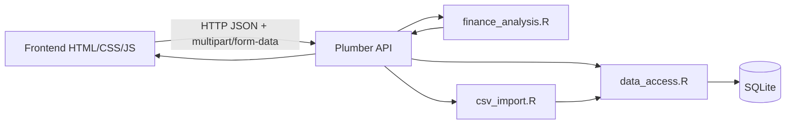

# Documento de arquitetura — DataPulse

## Visão geral

O DataPulse é uma aplicação local para acompanhamento financeiro pessoal e analítico, com dashboard em HTML/CSS/JavaScript, API REST em R usando Plumber e persistência em SQLite. O projeto foi construído para manter a lógica financeira centralizada no backend em R, evitando duplicação de regras no frontend.

A arquitetura atual reflete a implementação existente e não uma proposta futura. O sistema suporta CRUD de transações, filtros, cálculo financeiro, CSV import e testes automatizados sobre o fluxo real do sistema.

## Camadas e responsabilidades

### Frontend

- Arquivos: `app/frontend/index.html`, `app/frontend/css/styles.css`, `app/frontend/js/api.js`, `app/frontend/js/app.js`
- Responsabilidades:
  - renderizar dashboard, tabela e indicadores;
  - coletar dados do usuário para cadastro e importação CSV;
  - enviar requisições para a API em HTTP;
  - tratar estados de carregamento, erro e sucesso;
  - evitar cálculos financeiros duplicados no navegador.

### API REST em R (Plumber)

- Arquivo: `app/backend/api/plumber.R`
- Responsabilidades:
  - expor endpoints REST em JSON;
  - receber requisições do frontend;
  - validar payloads e arquivos de upload;
  - chamar serviços financeiros e persistência;
  - aplicar CORS por allowlist e lidar com preflight OPTIONS.

### Serviços financeiros

- Arquivo: `app/backend/services/finance_analysis.R`
- Responsabilidades:
  - validar transações;
  - calcular totais, despesas por categoria e resumo mensal;
  - receber dados filtrados e produzir a resposta analítica.

### Persistência SQLite

- Arquivo: `app/backend/services/data_access.R`
- Responsabilidades:
  - resolver o caminho do banco com validação explícita;
  - inicializar o schema de transações;
  - inserir, listar, consultar, atualizar e excluir registros;
  - manter transações e operações em SQLite com controle de integridade.

### Importação CSV

- Arquivo: `app/backend/services/csv_import.R`
- Responsabilidades:
  - ler arquivos CSV em UTF-8/BOM e com separadores reconhecidos;
  - normalizar cabeçalhos e datas;
  - validar registros e tipos de transação;
  - identificar duplicatas e linhas inválidas;
  - executar importação com preview e confirmação.

## Diagrama de arquitetura



## Fluxo principal

### 1. Dashboard e análise

1. O frontend acessa `GET /api/dashboard/summary` e `GET /api/transactions`.
2. O Plumber consulta a camada de dados em SQLite.
3. O serviço financeiro calcula totais e agregados.
4. O frontend renderiza indicadores, tabela e filtros.

### 2. Cadastro e edição

1. O frontend envia um JSON para `POST /api/transactions` ou `PUT /api/transactions/:id`.
2. A API valida os campos obrigatórios: `date`, `description`, `category`, `type`, `amount`.
3. A camada de persistência grava a transação em SQLite.
4. O retorno da API define a resposta visual do dashboard.

### 3. Importação de CSV

1. O usuário seleciona um arquivo CSV no dashboard.
2. O frontend envia o arquivo via multipart/form-data para `POST /api/import/csv`.
3. O backend valida estrutura, colunas, tipos, valores e duplicatas.
4. Em preview, a API não altera o banco.
5. Na confirmação, a API valida novamente e grava em transação SQLite.
6. O dashboard atualiza os indicadores após a importação bem-sucedida.

## Contratos da API

### Resposta padrão

```json
{
  "status": "success",
  "data": { ... },
  "meta": { "generatedAt": "2026-01-02T12:00:00Z" },
  "errors": []
}
```

Em caso de erro:

```json
{
  "status": "error",
  "data": null,
  "meta": { "generatedAt": "2026-01-02T12:00:00Z" },
  "errors": [{ "code": "INVALID_PAYLOAD", "message": "Detalhe do erro" }]
}
```

### Endpoints principais

- `GET /health`
  - retorna status geral do serviço.

- `GET /api/dashboard/summary`
  - retorna resumo do dashboard com receitas, despesas, saldo líquido e contagens.

- `GET /api/transactions`
  - retorna lista de transações do banco.

- `GET /api/transactions/<id>`
  - busca uma transação específica.

- `POST /api/transactions`
  - cadastra uma transação.

- `PUT /api/transactions/<id>`
  - atualiza uma transação.

- `DELETE /api/transactions/<id>`
  - remove uma transação.

- `POST /api/analyze`
  - recebe transações e filtros e devolve resumo financeiro em JSON.

- `POST /api/import/csv`
  - recebe um arquivo CSV para pré-visualização e importação confirmada.

## Formato das transações

A estrutura interna de uma transação é:

```json
{
  "date": "2026-01-02",
  "description": "Salário",
  "category": "Renda",
  "type": "income",
  "amount": 2500.00
}
```

Regras aplicadas:

- `date`: formato ISO `YYYY-MM-DD` internamente;
- `description`: texto obrigatório;
- `category`: categoria obrigatória;
- `type`: `income` ou `expense`;
- `amount`: número maior que zero.

## CSV canônico

O CSV importado usa a convenção:

```csv
date,description,category,type,amount
2026-01-02,Salário,Renda,income,2500.00
2026-01-03,Transporte,Transporte,expense,150.00
```

Suporte implementado:

- separadores `,` ou `;`
- UTF-8 com BOM
- cabeçalhos em inglês e em português
- datas em `YYYY-MM-DD` ou `DD/MM/YYYY`
- normalização de `type` para `income` e `expense`
- valores monetários em ponto decimal

## Integridade do SQLite

- O banco é inicializado com `CREATE TABLE IF NOT EXISTS` para não apagar dados existentes.
- O caminho do banco é resolvido por `resolve_db_path()` e validado antes do uso.
- O módulo de dados usa consultas parametrizadas para evitar concatenação de SQL.
- Operações de importação são executadas em transação; falhas geram rollback.
- Testes usam bancos temporários e isolados para evitar interferência no banco de desenvolvimento.

## Segurança e operação

### CORS

- A API usa allowlist explícita por variável de ambiente `DATAPULSE_ALLOWED_ORIGINS`.
- Requisições `OPTIONS` foram tratadas para preflight.
- `Access-Control-Allow-Origin: *` não é usado por padrão.
- CORS não substitui autenticação nem autorização.

### Paths e arquivos

- O caminho do SQLite não é controlado pelo cliente.
- O servidor valida se o caminho está vazio, aponta para diretório ou usa diretório pai inválido.
- Arquivos CSV são analisados apenas em memória/temporário; o conteúdo não é executado.

## Estrutura de diretórios do projeto

```text
DataPulse/
├── README.md
├── PROJECT_STATUS.md
├── requirements.R
├── .gitignore
├── app/
│   ├── backend/
│   │   ├── api/plumber.R
│   │   └── services/
│   │       ├── csv_import.R
│   │       ├── data_access.R
│   │       └── finance_analysis.R
│   ├── frontend/
│   │   ├── css/styles.css
│   │   ├── index.html
│   │   └── js/
│   │       ├── api.js
│   │       └── app.js
│   └── data/
│       └── sqlite/
├── docs/
│   └── arquitetura.md
├── tests/
│   ├── api/test_plumber_api.R
│   ├── db/test_sqlite_persistence.R
│   ├── finance/test_finance_analysis.R
│   └── import/test_csv_import.R
└── .Rprofile
```

## Observações operacionais

- Backend local padrão: `http://127.0.0.1:8001`
- Frontend local padrão: `http://127.0.0.1:4321`
- Banco local padrão: `DATAPULSE_DB_PATH` ou `app/data/sqlite/datapulse.db` quando não configurado
- O projeto é executado localmente para demonstração e validação técnica; não deve ser exposto publicamente sem autenticação e controles de acesso.

## Limites conhecidos

- ainda não há autenticação ou autorização por usuário;
- o sistema foi projetado para uso local e demonstração;
- os dados financeiros devem ser fictícios em qualquer ambiente compartilhado;
- a API não deve receber acesso público sem isolamento de rede, controles de acesso e políticas de armazenamento adequadas.
